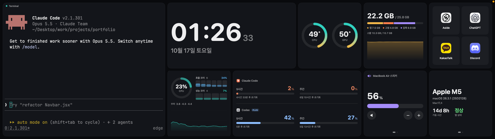
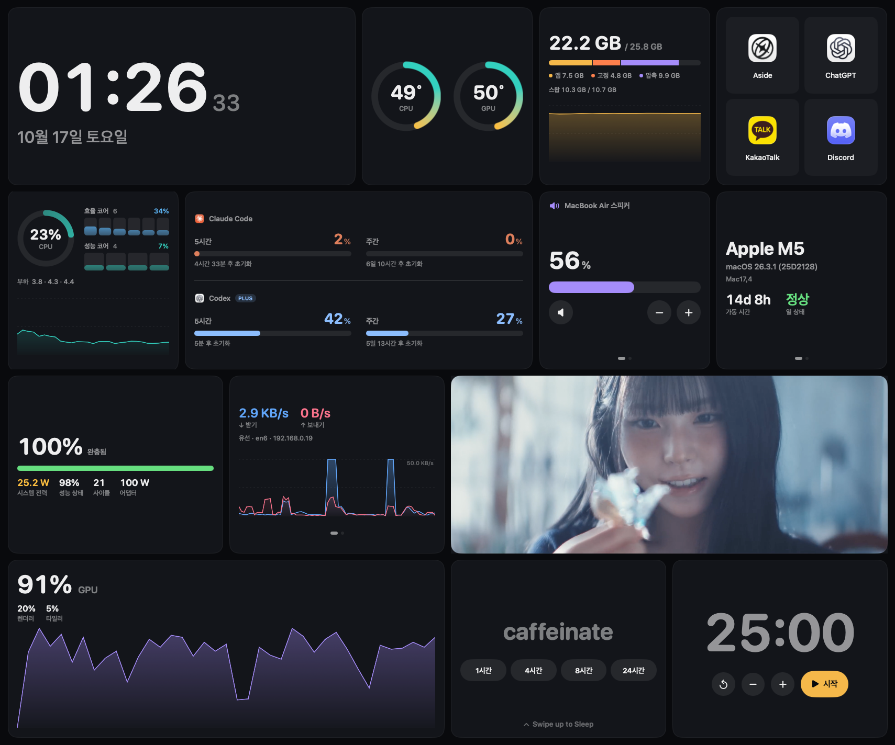
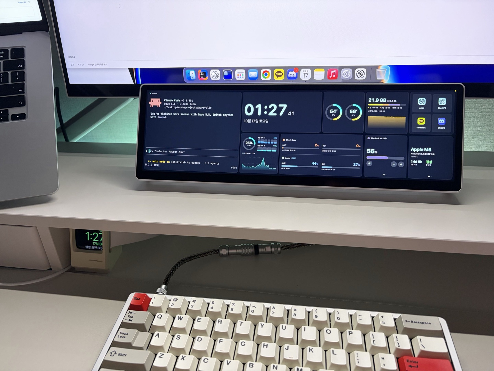

<div align="center">

# EdgeCompanion

Corsair XENEON EDGE용 macOS 전용 통합 앱입니다.

[](#요구-사항)
[](#요구-사항)
[](https://www.swift.org)
[](LICENSE)

[English](README.md) · **한국어**



</div>

macOS용 iCUE는 XENEON EDGE를 지원하지 않습니다. 터치가 다른 화면을 누르고, 패널 설정도 바꿀 수
없습니다. EdgeCompanion은 이 두 가지를 처리하고, Edge를 대시보드로 쓸 수 있게 합니다. Corsair와
관계없는 비공식 프로젝트입니다.

## 기능

- 터치 입력을 Edge 좌표에 맞춥니다. 탭, 더블탭, 관성 스크롤, 누른 뒤 끌기, 길게 눌러 우클릭을
  지원합니다. 대시보드를 터치할 때는 마우스 커서가 움직이지 않습니다.
- 대시보드 위젯: 시계, 코어별 CPU, GPU, 메모리, 네트워크·디스크, 온도, 전원과 블루투스 기기
  배터리, Claude Code·Codex 사용 한도, 볼륨과 출력 장치, 타이머(±1분), 앱 런처, 시스템 정보. 한쪽에
  터미널을 둘 수 있습니다.
- 시계 위젯의 두 번째 페이지에 Apple Music 재생 화면이 있습니다. 앨범 아트, 곡 정보, 진행 바(탭해서
  이동), 재생 버튼을 보여 줍니다. 음악이 재생되면 시계보다 먼저 나오고, 재생을 멈추면 시계로 돌아갑니다.
- 웹페이지 위젯은 설정한 주소의 페이지를 띄우고, 앱을 다시 켜도 로그인 상태를 유지합니다.
- 사진·영상 위젯은 여러 개 넣을 수 있고, 사진, GIF, 영상을 카드에 꽉 채워 소리 없이 끝없이 반복
  재생합니다. Edge가 꺼져 있으면 재생을 멈추고, 탭하면 멈추거나 이어서 재생합니다.
- 잠자기 위젯은 맥과 디스플레이를 1, 4, 8, 24시간 동안 깨어 있게 합니다(`caffeinate -d`와 같음).
  위젯을 위로 밀고 한 번 더 탭하면 맥을 잠재웁니다.
- 위젯 크기는 1×1, 2×1, 1×2, 2×2입니다. 대시보드 페이지를 여러 개 만들 수 있고, 위젯 안에도
  페이지가 있습니다. 배치는 설정의 편집기에서 바꿉니다.
- DDC/CI로 패널의 화이트 밸런스를 설정합니다. 값이 패널에 저장되므로 앱을 종료해도 유지됩니다.
  D65 프리셋으로 출고 상태의 푸른 흰색을 보정합니다.
- 대시보드 모드에서는 마우스 커서가 Edge로 들어가지 않고(<kbd>Option</kbd>을 누르면 들어감), Dock도
  Edge로 옮겨지지 않습니다. Edge로 간 다른 앱 창은 메인 화면으로 옮깁니다.
- 패널을 시리얼 번호로 구분하고, 다시 연결하거나 잠자기에서 깨어나면 설정을 다시 적용합니다.
- 대시보드가 보일 때 CPU 한 코어의 1~2% 정도를 사용합니다. Edge가 꺼져 있거나 분리되면 측정을
  멈춥니다.
- 영어와 한국어 UI를 지원합니다.

## 위젯

<p align="center">
  
</p>

## 사용 모습

<p align="center">
  
</p>

## 요구 사항

- Apple Silicon Mac, macOS 14 이상 (macOS 26, MacBook Air M5 15형에서 테스트됨)
- USB-C(DisplayPort Alt Mode)로 연결한 XENEON EDGE (DDC/CI 사용)
- Xcode 또는 Command Line Tools (Swift 6)

## 설치

아직 배포용 빌드는 없습니다. 소스에서 빌드합니다.

```sh
git clone https://github.com/Seol-JY/xeneon-edge-companion.git
cd xeneon-edge-companion
scripts/make-cert.sh            # 최초 1회: 로컬 자체 서명 인증서 생성
scripts/build-app.sh --install  # 빌드 후 ~/Applications에 복사하고 실행
```

macOS는 개인정보 권한을 코드 서명에 연결합니다. 로컬 인증서로 서명하면 다시 빌드해도 권한이
유지되고, 임시(ad-hoc) 서명이면 빌드할 때마다 다시 허용해야 합니다. 다른 인증서를 쓰려면
`SIGN_ID`를 지정하거나 `.signing-identity` 파일에 이름을 적습니다. 번들 ID는 `BUNDLE_ID`로 바꿀 수
있습니다.

처음 실행할 때 요청하는 권한:

| 권한 | 용도 |
|---|---|
| 입력 모니터링 | 터치 컨트롤러 읽기 |
| 손쉬운 사용 | 다른 앱 창 터치, 포인터 가드, 창 이동 |
| 자동화(Music) | Apple Music의 앨범 아트, 재생 위치, 재생 버튼. 처음 음악을 재생할 때 요청하며, 허용하지 않아도 곡 정보는 보입니다 |

## 사용법

메뉴 막대 메뉴에서 Edge와 터치 상태를 확인하고, 대시보드 모드와 일반 모니터 모드를 전환하고, 색
프리셋을 적용하고, 설정을 엽니다.

- 손가락을 움직이면 스크롤, 잠시 누른 뒤 움직이면 드래그, 누른 채로 있으면 우클릭입니다.
- 대시보드에서 옆으로 밀면 페이지가 바뀝니다. 아래에 점이 있는 위젯은 자체 페이지가 있으며, 위젯
  위에서 밀거나 점을 누릅니다.
- 설정 → 대시보드 → 위젯 배치에서 타일을 끌어 순서를 바꾸고, 타일을 눌러 크기 변경, 다른 페이지로
  이동, 삭제를 합니다. 빈 칸이 필요하면 "빈 공간" 타일을 씁니다.
- 웹페이지 위젯: 설정 → 대시보드 → 웹페이지 위젯에서 주소와 확대 비율을 정합니다. "확인하기"를 누르면
  메인 화면에 같은 페이지를 창으로 열며, 로그인이 필요할 때 씁니다. 위젯과 쿠키를 함께 씁니다. 링크를
  따라 다른 페이지로 가면 위젯에 홈 버튼이 나타납니다.
- 사진·영상 위젯: 위젯 배치에서 타일을 누른 뒤 "파일 선택…"을 누릅니다. 파일은
  `~/Library/Application Support/EdgeCompanion/Media`에 복사되므로 원본을 옮기거나 지워도 됩니다.
  "채우기"는 카드에 맞춰 자르고, "맞추기"는 전체를 보여 줍니다.
- tmux가 설치되어 있으면 터미널이 별도 tmux 서버에서 실행되어 앱을 다시 시작해도 유지됩니다. 다른
  터미널에서는 `tmux -L edge attach -t edge`로 접속합니다.

### Claude Code와 Codex 사용량

사용량 위젯은 두 도구의 5시간 한도와 주간 한도를 표시합니다. 로그인 토큰은 읽지 않습니다.

- Claude Code 2.1.80 이상은 설정된 상태줄(status line) 명령에 사용 한도 정보를 전달합니다. 설정 →
  대시보드 → 사용량 → 연결을 누르면 EdgeCompanion이 그 명령으로 등록됩니다. 등록 전에
  `~/.claude/settings.json`을 백업하며, 이미 다른 상태줄이 있으면 바꾸지 않습니다. 저장하는 값은
  사용률과 초기화 시각뿐이고, Claude Code 상태줄에는 `5h 12% · 7d 30%`가 표시됩니다.
- Codex는 Codex CLI의 `app-server`에 `account/rateLimits/read`를 요청합니다. 인증 요청은 CLI가 직접
  보냅니다. CLI가 없으면 마지막 세션 기록을 사용합니다.

Anthropic 약관은 Claude 구독의 OAuth 토큰을 다른 앱에서 쓰는 것을 허용하지 않으므로, 상태줄 방식을
사용합니다.

### 색 설정

설정 → 색상에서 패널의 RGB 게인을 씁니다(0x14로 고른 User 1 프리셋에서 VCP 0x16, 0x18, 0x1A).
그 밖의 VCP 코드는 쓰지 않습니다. 버튼이 없는 패널을 꺼 버릴 수 있는 입력 전환, 전원, 공장 초기화도
여기에 포함됩니다. 밝기는 MonitorControl 같은 도구로 조절합니다.

## 개인정보와 보안

- 네트워크 요청은 켜 둔 기능에서만 보냅니다. 웹페이지 위젯은 설정한 페이지를 불러오고, 앨범 아트가
  없는 Apple Music 곡은 커버를 찾기 위해 곡명과 아티스트를 Apple의 iTunes Search API로 보냅니다.
  사용량 위젯이 표시될 때 Codex CLI가 자체 요청을 보냅니다.
- Apple Music 정보는 Music 앱의 알림과 AppleScript로 읽습니다. macOS가 처음 한 번 자동화 권한을
  묻습니다.
- Claude Code를 연결하면 `~/.claude/settings.json` 옆에 시각이 붙은 백업을 만든 뒤 파일을 다시
  저장합니다. 연결을 해제하면 해당 항목을 지웁니다.
- Codex CLI가 없을 때는 최신 Codex 세션 기록에서 `rate_limits` 항목만 읽습니다.
- 설정은 사용자 기본값(user defaults)에, 로그는 `~/Library/Logs/EdgeCompanion`에 저장합니다.
- SMC 센서, DDC, 터치 컨트롤러에 직접 접근해야 해서 샌드박스를 쓰지 않습니다.
- 일부 기능은 macOS 비공개 API(`IOAVService`를 통한 DDC, 백그라운드 커서 숨김)를 씁니다. 모두 선택
  기능이며, 실패해도 앱은 계속 동작합니다.

## 자주 묻는 질문

<details>
<summary><b>멀티터치가 되나요?</b></summary>

되지 않습니다. 패널 펌웨어가 Windows에서만 멀티터치를 켜고 macOS에서는 한 지점만 보고하므로,
모든 제스처는 한 손가락 기준입니다.
</details>

<details>
<summary><b>다른 앱이 터치 장치를 사용 중이라고 나옵니다.</b></summary>

터치 컨트롤러는 한 번에 한 앱만 열 수 있습니다. 다른 XENEON EDGE 터치 드라이버를 종료하십시오.
</details>

<details>
<summary><b>로그는 어디에 있나요?</b></summary>

`~/Library/Logs/EdgeCompanion/EdgeCompanion.log`와 설정 → 진단에서 확인할 수 있습니다.
</details>

## 개발

```
Sources/EdgeCore        단위 테스트가 있는 로직: 터치 리포트, 제스처, 좌표 변환, DDC 패킷, 포인터·그리드 계산
Sources/EdgeCompanion   앱: 디스플레이, 색, 터치, 포인터 가드, 대시보드, 센서, 사용량, 설정
Tests/EdgeCoreTests     단위 테스트 (swift-testing)
scripts/                빌드, 서명, 테스트 스크립트
```

```sh
scripts/test.sh                                   # 단위 테스트
dist/EdgeCompanion.app/Contents/MacOS/EdgeCompanion --render-widgets /tmp/w timer volume   # 위젯을 PNG로 렌더링
```

## 참고한 프로젝트

일부 코드와 방식은 [exelban/stats](https://github.com/exelban/stats),
[vladkens/macmon](https://github.com/vladkens/macmon), [MonitorControl](https://github.com/MonitorControl/MonitorControl),
[DockAnchor](https://github.com/bwya77/DockAnchor), [SwiftTerm](https://github.com/migueldeicaza/SwiftTerm)에서
가져왔습니다. 터치 프로토콜 정보는 커뮤니티의 XENEON EDGE 드라이버 프로젝트들을 참고했습니다. 터미널
글꼴은 [Nerd Fonts](https://github.com/ryanoasis/nerd-fonts) 아이콘이 추가된
[JetBrains Mono](https://github.com/JetBrains/JetBrainsMono)입니다.
[THIRD_PARTY_NOTICES.md](THIRD_PARTY_NOTICES.md)에 정리되어 있습니다.

## 피드백

버그나 제안은 [Issues](../../issues)에 남겨 주십시오. macOS 버전과 설정 → 진단의 로그를 함께 적어
주시면 원인을 찾기 쉽습니다. 유용하게 쓰셨다면 Star를 눌러 주십시오. 다른 XENEON EDGE 사용자가
프로젝트를 찾는 데 도움이 됩니다.

## 면책 조항

이 소프트웨어는 어떠한 보증 없이 있는 그대로 제공됩니다. DDC/CI로 디스플레이 설정을 쓰고, 터치
컨트롤러를 점유하고, 입력 이벤트를 만들어 보내고, macOS 비공개 API를 사용합니다. 사용에 따른
책임은 사용자에게 있으며, 사용으로 인해 발생하는 손상, 데이터 손실, 하드웨어 문제를 포함한 모든
문제에 대해 개발자는 책임을 지지 않습니다.

## 라이선스

[MIT](LICENSE). CORSAIR와 XENEON은 해당 소유자의 상표이며, 하드웨어 이름을 표기하는 용도로만
사용했습니다.
